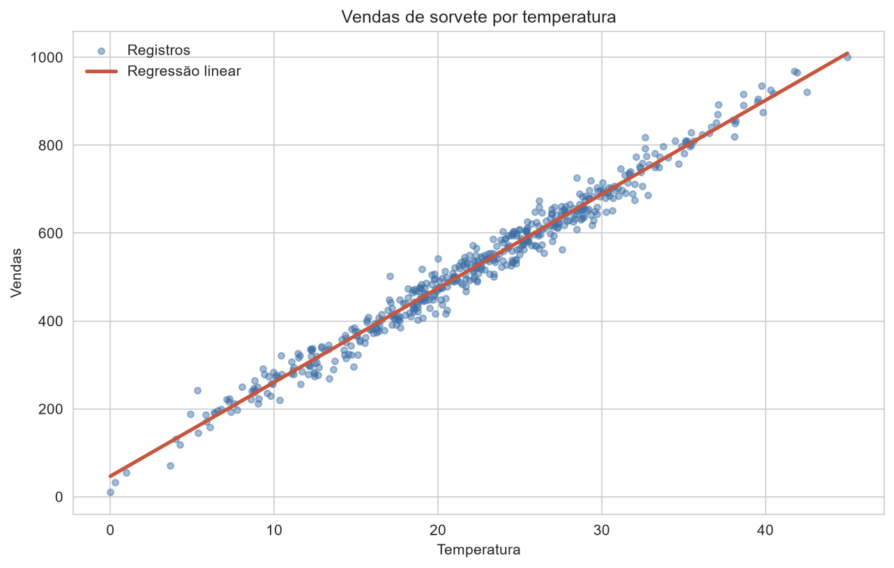

# Vendas de sorvete e temperatura

Análise em Python com um modelo de regressão linear que estima as vendas de sorvete a partir da temperatura.

**Pergunta:** quanto a temperatura explica as vendas? Nesta base, quase tudo: a reta explica 97,7% da variação das vendas nos dados de teste.



## Principais resultados

| Métrica (dados de teste) | Modelo | Usando só a média |
| --- | --- | --- |
| R² | 0,977 | Não se aplica |
| Erro médio absoluto (MAE) | 19,2 | 132,9 |
| Raiz do erro quadrático médio (RMSE) | 25,5 | 169,4 |

- Temperatura e vendas têm correlação de 0,99.
- Cada grau a mais soma cerca de 21,4 em vendas: `vendas = 46,8 + 21,4 x temperatura`.
- Curvas de grau 2 e 3 não superam a reta (R² médio de 0,979 nos três casos, em validação cruzada), então a reta é a melhor escolha.

## Como foi feito

1. Conferência da base (500 linhas, sem valores ausentes ou duplicados).
2. Separação de 20% dos dados para teste, com semente fixa.
3. Treino da regressão linear com scikit-learn e comparação com a média.
4. Validação cruzada em 5 partes e análise dos erros do modelo.

A análise completa está em [`Ice-cream.ipynb`](Ice-cream.ipynb).

## Como rodar

```bash
pip install -r requirements.txt
jupyter notebook Ice-cream.ipynb
```

## Limites

A temperatura é a única variável, e o resultado mostra associação, não causa. O ajuste tão alto e os extremos em valores redondos sugerem uma base didática, e não vendas reais. A unidade da temperatura não está documentada: Celsius é a leitura mais plausível, porque ela vai de 0 a 45, com média de 22.
